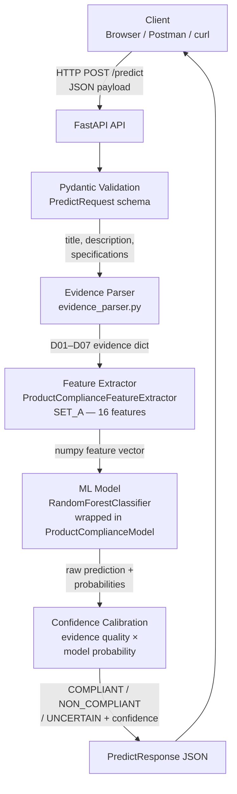
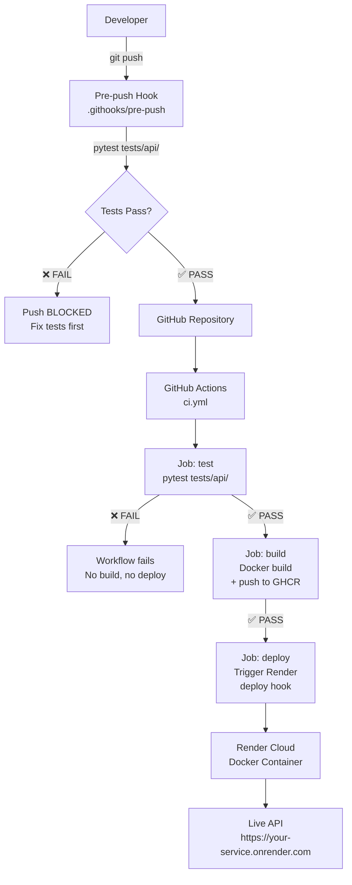
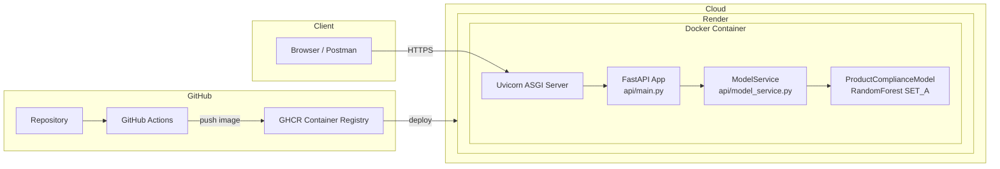

# NitiMark — Product Compliance ML API

> **College Assignment**: Distributed Systems & Cloud Computing — ML Model Deployment

[](https://github.com/DevAbhay07/ComplianceIdentifier_CC/actions/workflows/ci.yml)
[](https://python.org)
[](https://fastapi.tiangolo.com)
[](https://docker.com)
[](LICENSE)

---

## 1. Problem Statement

E-commerce platforms host millions of packaged commodity product listings. Under India's **Legal Metrology (Packaged Commodities) Rules**, every pre-packaged product must prominently display seven mandatory declarations on its packaging:

| Code | Declaration |
|------|-------------|
| D01 | Name & address of manufacturer / packer / importer |
| D02 | Generic or common name of the commodity |
| D03 | Net quantity in standard units |
| D04 | Date of manufacture / packing / expiry |
| D05 | Maximum Retail Price (MRP) inclusive of taxes |
| D06 | Consumer care contact details |
| D07 | Country of origin |

Manual verification of millions of listings is impractical. **NitiMark** is an AI-powered compliance screening system that automatically classifies product listings as **COMPLIANT**, **NON_COMPLIANT**, or **UNCERTAIN** based on their textual product information.

This project wraps the existing NitiMark ML model in a production-ready REST API, containerizes it with Docker, deploys it to the cloud via Render, and automates the full CI/CD pipeline using GitHub Actions.

---

## 2. Objectives

- ✅ Expose the existing ML compliance classifier through a REST API (FastAPI)
- ✅ Validate all client inputs with Pydantic v2 schemas
- ✅ Containerize the application with Docker
- ✅ Automate testing with pytest (≥ 4 test cases)
- ✅ Block pushes when tests fail (Git pre-push hook)
- ✅ Implement CI/CD with GitHub Actions
- ✅ Push Docker images to GitHub Container Registry (GHCR)
- ✅ Deploy to cloud (Render) via automated deploy hook
- ✅ Demonstrate client-server architecture

---

## 3. Technology Stack

| Layer | Technology |
|-------|-----------|
| Language | Python 3.11 |
| API Framework | FastAPI 0.115 |
| ML Framework | scikit-learn (RandomForestClassifier) |
| Input Validation | Pydantic v2 |
| ASGI Server | Uvicorn |
| Testing | pytest + FastAPI TestClient (httpx) |
| Containerization | Docker + Docker Compose |
| Version Control | Git + GitHub |
| CI/CD | GitHub Actions |
| Container Registry | GitHub Container Registry (GHCR) |
| Cloud Deployment | Render (Docker-based web service) |

---

## 4. Architecture

### 4.1 Inference Pipeline



### 4.2 CI/CD Pipeline



### 4.3 System Components



---

## 5. Project Structure

```
ComplianceIdentifier_CC/               ← repository root
│
├── api/                               ← FastAPI application (NEW)
│   ├── __init__.py
│   ├── main.py                        ← FastAPI app, endpoints (/, /health, /predict)
│   ├── model_service.py               ← ML inference abstraction (ModelService class)
│   └── schemas.py                     ← Pydantic request/response schemas
│
├── src/                               ← Existing NitiMark ML source (preserved)
│   ├── decision/
│   │   └── product_compliance_decision.py
│   ├── extraction/
│   │   ├── declaration_extractor.py
│   │   └── declaration_schema.py
│   ├── features/
│   │   ├── product_compliance_feature_extractor.py   ← SET_A–E features
│   │   └── product_training_representation.py
│   ├── inference/
│   │   ├── evidence_parser.py         ← D01–D07 evidence from text
│   │   └── …
│   └── models/
│       ├── product_compliance_model.py ← ProductComplianceModel wrapper
│       └── train_product_compliance.py ← Original training code
│
├── models/
│   └── product_compliance/
│       └── best_product_compliance_model.joblib  ← Frozen RandomForest model
│
├── tests/
│   └── api/                           ← API test suite (NEW)
│       ├── conftest.py                ← Shared fixtures (TestClient, payloads)
│       ├── test_health.py             ← TEST 1: Health endpoint
│       ├── test_prediction.py         ← TEST 2: Valid prediction
│       ├── test_invalid_input.py      ← TEST 3: Invalid input → 422
│       └── test_prediction_schema.py  ← TEST 4: Response schema validation
│
├── scripts/
│   └── train_model.py                 ← Reproducible training script (NEW)
│
├── .github/
│   └── workflows/
│       └── ci.yml                     ← GitHub Actions CI/CD (NEW)
│
├── .githooks/
│   └── pre-push                       ← Local push protection hook (NEW)
│
├── Dockerfile                         ← Production Docker image (NEW)
├── .dockerignore                      ← Docker build context filter (NEW)
├── docker-compose.yml                 ← Local development compose (NEW)
├── render.yaml                        ← Render deployment config (NEW)
├── requirements.txt                   ← Python dependencies (updated)
├── pytest.ini                         ← pytest configuration (updated)
├── .gitignore                         ← Updated with secrets exclusions
├── .env.example                       ← Template (never commit .env!)
└── README.md                          ← This file
```

---

## 6. ML Model

### Model Details

| Property | Value |
|----------|-------|
| Algorithm | RandomForestClassifier (scikit-learn) |
| Wrapper | `ProductComplianceModel` (custom, with abstention logic) |
| Feature Set | **SET_A — 16 features** |
| Output Classes | `COMPLIANT`, `NON_COMPLIANT`, `UNCERTAIN` |
| Serialization | `joblib` |
| Artifact | `models/product_compliance/best_product_compliance_model.joblib` |

### SET_A Features (16 total)

The model uses the following 16 binary/continuous features extracted from product text:

| Feature | Description |
|---------|-------------|
| `d01_present` | Manufacturer/packer name & address present (0/1) |
| `d01_confidence` | Extraction confidence for D01 (0.0–1.0) |
| `d02_present` | Generic commodity name present (0/1) |
| `d02_confidence` | Extraction confidence for D02 |
| `d03_present` | Net quantity present (0/1) |
| `d03_confidence` | Extraction confidence for D03 |
| `d04_present` | Date of manufacture/expiry present (0/1) |
| `d04_confidence` | Extraction confidence for D04 |
| `d05_present` | MRP present (0/1) |
| `d05_confidence` | Extraction confidence for D05 |
| `d06_present` | Consumer care contact present (0/1) |
| `d06_confidence` | Extraction confidence for D06 |
| `d07_present` | Country of origin present (0/1) |
| `d07_confidence` | Extraction confidence for D07 |
| `mandatory_declarations_present_count` | Count of declarations found (0–7) |
| `all_mandatory_present` | 1 if ≥ 6 of 7 declarations found |

### Validation Metrics (from training run)

| Metric | Value |
|--------|-------|
| Accuracy | 1.00 |
| Balanced Accuracy | 1.00 |
| Macro F1 | 1.00 |
| MCC | 1.00 |
| Support (COMPLIANT) | 19 samples |
| Support (NON_COMPLIANT) | 303 samples |

> **Note**: Perfect validation metrics are expected given the deterministic nature of SET_A features — when all 7 mandatory declarations are present, the product is COMPLIANT; when declarations are absent, it is NON_COMPLIANT. The model serves as a learned classifier over this structured signal.

### Abstention (UNCERTAIN)

The model returns `UNCERTAIN` when:
- Prediction confidence < 0.65 (threshold)
- Probability margin between top 2 classes < 0.20
- Evidence conflicts are detected

### Confidence Calibration

```
calibrated_confidence = raw_model_probability × ocr_quality_factor × completeness_factor
```

This prevents overconfident predictions when input evidence is sparse or ambiguous.

### Retraining

```bash
python scripts/train_model.py
```

> ⚠️ This overwrites `models/product_compliance/best_product_compliance_model.joblib`. Back up before running.

---

## 7. API Reference

### Base URL

**Local**: `http://localhost:8000`  
**Production**: `https://nitimark-compliance-api.onrender.com`

### Endpoints

#### `GET /` — Service Information

```bash
curl http://localhost:8000/
```

```json
{
  "service": "NitiMark — Product Compliance ML API",
  "version": "1.0.0",
  "status": "running",
  "docs_url": "/docs"
}
```

---

#### `GET /health` — Health Check

```bash
curl http://localhost:8000/health
```

```json
{
  "status": "healthy",
  "model_loaded": true,
  "model_name": "RandomForest",
  "feature_set": "SET_A"
}
```

---

#### `POST /predict` — Compliance Prediction

**Request body** (at least one of `title` or `description` required):

```bash
curl -X POST http://localhost:8000/predict \
  -H "Content-Type: application/json" \
  -d '{
    "title": "Colgate Strong Teeth Toothpaste 200g",
    "description": "Manufactured by Colgate-Palmolive (India) Ltd, Mumbai 400026. MRP Rs. 109 (incl. of all taxes). Net Qty: 200 g. Best Before: 24 months from mfg. Country of Origin: India. Consumer Care: 1800-22-4080.",
    "specifications": {"Brand": "Colgate", "Net Quantity": "200 g"},
    "retail_price": 109.0
  }'
```

**Response**:

```json
{
  "prediction": "COMPLIANT",
  "confidence": 0.9248,
  "raw_prediction": "COMPLIANT",
  "decision_basis": "All mandatory statutory declarations verified on packaging",
  "uncertainty": {
    "status": "LOW",
    "score": 0.0752,
    "reason": null,
    "abstained": false
  },
  "declarations_evidence": {
    "D01": {
      "declaration_name": "Name & Address of Manufacturer / Packer / Importer",
      "evidence_detected": true,
      "evidence_text": "Entity: Colgate-Palmolive (India) Ltd | Address Markers: Mumbai",
      "source": "OCR_AND_METADATA"
    },
    "D02": { "declaration_name": "Generic or Common Name of Commodity", "evidence_detected": true, ... },
    "D03": { "declaration_name": "Net Quantity in Standard Units", "evidence_detected": true, ... },
    "D04": { "declaration_name": "Date of Manufacture / Packing / Expiry", "evidence_detected": true, ... },
    "D05": { "declaration_name": "Maximum Retail Price (MRP) & Tax Inclusivity", "evidence_detected": true, ... },
    "D06": { "declaration_name": "Consumer Care Details (Phone / Email / Address)", "evidence_detected": true, ... },
    "D07": { "declaration_name": "Country of Origin", "evidence_detected": true, ... }
  },
  "model_version": "v2.0-product-compliance",
  "feature_set": "SET_A",
  "disclaimer": "Automated Legal Metrology compliance screening. Not a statutory judicial determination."
}
```

**Validation errors** (422):

```bash
curl -X POST http://localhost:8000/predict -H "Content-Type: application/json" -d '{}'
# → HTTP 422 with validation error details
```

---

### Swagger Documentation

Interactive API documentation is auto-generated by FastAPI:

| URL | Description |
|-----|-------------|
| `/docs` | Swagger UI — interactive testing |
| `/redoc` | ReDoc UI — readable documentation |
| `/openapi.json` | Raw OpenAPI schema |

---

## 8. Local Setup

### Prerequisites

- Python 3.11+
- `git`
- Docker (optional, for container testing)

### Step-by-step

```bash
# 1. Clone the repository
git clone https://github.com/DevAbhay07/ComplianceIdentifier_CC.git
cd ComplianceIdentifier_CC

# 2. Create and activate virtual environment
# Linux / macOS:
python -m venv .venv
source .venv/bin/activate

# Windows:
python -m venv .venv
.venv\Scripts\activate

# 3. Install dependencies
pip install -r requirements.txt

# 4. Run tests
pytest -q

# 5. Start the API server
uvicorn api.main:app --host 0.0.0.0 --port 8000 --reload

# 6. Open in browser:
#   http://localhost:8000/docs      ← Swagger UI
#   http://localhost:8000/health    ← Health check
```

---

## 9. Docker Setup

### Build and run

```bash
# Build the Docker image
docker build -t product-compliance-api .

# Run the container
docker run --rm -p 8000:8000 product-compliance-api

# Verify:
curl http://localhost:8000/health
curl http://localhost:8000/
# Open http://localhost:8000/docs in browser
```

### Using Docker Compose (local development)

```bash
docker compose up --build

# Background:
docker compose up -d --build

# Stop:
docker compose down
```

---

## 10. Tests

The test suite uses **FastAPI's TestClient** (backed by `httpx`) — no running server needed.

### Running tests

```bash
pytest -q                     # Run all API tests (quiet)
pytest -v                     # Verbose output
pytest tests/api/test_health.py  # Single file
```

### Test Coverage

| Test File | What it Tests |
|-----------|--------------|
| `test_health.py` **(TEST 1)** | `GET /health` returns 200, `status=healthy`, `model_loaded` is bool, metadata present when model loaded |
| `test_prediction.py` **(TEST 2)** | `POST /predict` returns 200 for valid payloads; `prediction` is a valid label; `confidence` is float in [0,1]; minimal and full payloads both work |
| `test_invalid_input.py` **(TEST 3)** | Empty body → 422; empty strings → 422; negative price → 422; non-dict specifications → 422; 422 response includes `detail` field |
| `test_prediction_schema.py` **(TEST 4)** | All required response keys present; correct types; `prediction` is valid label; `uncertainty` structure correct; all D01–D07 declaration entries present; `model_version`, `feature_set`, `disclaimer` are non-empty |

**Total test functions: 29** across 4 test files (5 health, 6 prediction, 7 invalid input, 11 schema).

---

## 11. Local Push Protection (Pre-push Hook)

The Git pre-push hook blocks pushes when tests fail.

### Setup (one-time, per developer)

```bash
# Enable the custom hooks directory
git config core.hooksPath .githooks

# Make the hook executable
chmod +x .githooks/pre-push
```

### Behaviour

```
git push
    │
    ▼
.githooks/pre-push
    │
    ├── pytest tests/api/ -q
    │       │
    │       ├── ❌ FAIL → push REJECTED (exit 1)
    │       │
    │       └── ✅ PASS → push ALLOWED (exit 0)
    │
    └── (push proceeds to GitHub)
```

> **Important distinction**:
> - **Local push blocking** = `pre-push` hook → `pytest` on developer's machine → failed tests reject the push
> - **Remote merge protection** = GitHub branch protection + required `test` status check → failed CI prevents merging into `main`

---

## 12. GitHub Actions CI/CD

### Workflow file: `.github/workflows/ci.yml`

**Triggers**: `push` and `pull_request` to `main` / `master`

### Jobs

```
push to GitHub
    │
    ▼
Job 1: test
  ├── Checkout code
  ├── Setup Python 3.11
  ├── pip install -r requirements.txt
  └── pytest tests/api/ -v
          │
          ├── ❌ FAIL → workflow stops here, no build, no deploy
          │
          └── ✅ PASS
                │
                ▼
Job 2: build   (needs: test)
  ├── Login to GHCR (on push events)
  ├── Extract Docker tags (latest + sha-XXXXXXX)
  └── docker build + push to ghcr.io/<owner>/<repo>
          │
          └── ✅ PASS
                │
                ▼
Job 3: deploy  (needs: build, only on push to main)
  └── curl RENDER_DEPLOY_HOOK_URL  ← triggers Render redeployment
```

### GitHub Secrets Required

| Secret | Where to get it | Purpose |
|--------|----------------|---------|
| `RENDER_DEPLOY_HOOK_URL` | Render Dashboard → Service → Settings → Deploy Hook | Triggers Render redeployment from CI |
| `GITHUB_TOKEN` | Auto-provided by GitHub Actions | Push Docker image to GHCR |

> `GITHUB_TOKEN` is automatically available in every Actions run — you do not need to create it manually.

---

## 13. Render Deployment

### Why Render instead of EC2?

Render provides **managed cloud deployment** — you push a Dockerfile and Render handles provisioning, networking, HTTPS, and zero-downtime deploys. EC2 requires manual server provisioning, OS configuration, reverse proxy setup, and SSL certificate management. For a college assignment focused on architecture and CI/CD concepts, Render offers faster iteration without sacrificing the core cloud deployment learning objective.

### Setup Steps (Manual — requires your Render account)

1. **Create Render account** at [render.com](https://render.com)

2. **Create a new Web Service**:
   - Dashboard → New → Web Service
   - Connect your GitHub repository (`ComplianceIdentifier_CC`)
   - Select **Docker** as the runtime
   - Dockerfile path: `./Dockerfile`
   - Port: `8000`
   - Plan: **Free** (acceptable for demo; free tier spins down after 15min inactivity)

3. **Configure environment variables** in Render:
   - `INFERENCE_LOGGING_ENABLED` = `false`

4. **Copy the Deploy Hook URL**:
   - Service → Settings → Deploy Hook
   - Copy the URL (it looks like `https://api.render.com/deploy/srv-xxxxx?key=yyyy`)

5. **Add the Deploy Hook to GitHub Secrets**:
   - GitHub repo → Settings → Secrets and variables → Actions
   - New secret: `RENDER_DEPLOY_HOOK_URL` = `<your deploy hook URL>`

6. **Push to main** → GitHub Actions runs → Tests pass → Docker image pushed to GHCR → Render deploy hook triggered → Render pulls and deploys the new container.

7. **Get your public URL**:
   - Render Dashboard → your service → URL (e.g., `https://nitimark-compliance-api.onrender.com`)

---

## 14. GitHub Branch Protection (Remote Merge Protection)

To require the `test` CI job to pass before any PR can merge into `main`:

1. Go to: GitHub repo → Settings → Branches
2. Click **Add branch protection rule**
3. Branch name pattern: `main`
4. Enable: ✅ **Require status checks to pass before merging**
5. Search for and add: `Run Tests` (the CI job name)
6. Enable: ✅ **Require branches to be up to date before merging**
7. Click **Save changes**

> This configuration must be done manually in the GitHub UI — it cannot be set from source code.

---

## 15. CI/CD Flow Diagram

```
Developer
    │
    │  git push
    ▼
.githooks/pre-push
    │  pytest tests/api/
    ├── ❌ FAIL → Push BLOCKED
    └── ✅ PASS
            │
            ▼
    GitHub Repository
            │
            ▼
    GitHub Actions (ci.yml)
            │
    ┌───────┴────────────────────┐
    │   Job: test                │
    │   pytest tests/api/ -v     │
    └───────┬────────────────────┘
            │
    ┌───────┴────────────────────┐
    │   Job: build               │
    │   docker build             │
    │   push → GHCR              │
    └───────┬────────────────────┘
            │
    ┌───────┴────────────────────┐
    │   Job: deploy              │
    │   curl RENDER_DEPLOY_HOOK  │
    └───────┬────────────────────┘
            │
            ▼
        Render
        Docker Container
        FastAPI API
            │
            ▼
    https://your-service.onrender.com/
```

---

## 16. Screenshots to Capture

For your assignment submission and viva, capture these screenshots:

| # | Screenshot | Where to get it |
|---|-----------|----------------|
| 1 | **GitHub repo structure** | GitHub → Code tab → file tree |
| 2 | **Passing pytest** | Run `pytest -v` locally in terminal |
| 3 | **Failed pytest + blocked push** | Edit a test to make it fail, run `git push` |
| 4 | **GitHub Actions — passing workflow** | Actions tab → successful run |
| 5 | **GitHub Actions — failing workflow** | Actions tab → run where a test fails |
| 6 | **Docker image built** | GHCR package page or `docker images` output |
| 7 | **Render deployment dashboard** | Render service → Logs/Events tab |
| 8 | **Render live service URL** | Render service → URL field |
| 9 | **FastAPI /docs page** | Browser → `http://localhost:8000/docs` |
| 10 | **Successful /predict response** | Swagger UI or Postman → POST /predict |

---

## 17. Limitations

- The model was trained primarily on Flipkart catalog text data; real-world performance may vary for other retailers or product categories.
- The evidence parser uses regex-based extraction, which may miss non-standard formatting.
- The model does not process product images (image analysis was a separate pipeline requiring a Vision API key).
- Render's free tier spins down after 15 minutes of inactivity — the first request after a cold start may take 30–60 seconds.
- The abstention threshold (0.65) is fixed; in production, this would be calibrated per product category.

---

## 18. Future Improvements

- **API authentication**: JWT bearer tokens or API keys to restrict access
- **Rate limiting**: Protect against abuse with request throttling
- **Structured logging**: JSON logs for observability (e.g., via Datadog or Grafana)
- **Model versioning**: Support multiple model versions with A/B routing
- **Database integration**: Persist prediction history for analytics
- **Horizontal scaling**: Multiple Uvicorn workers behind a load balancer
- **Image analysis**: Re-integrate the Vision API pipeline for packaging image analysis
- **Monitoring**: Model drift detection and prediction distribution tracking

---

## 19. Conclusion

This project demonstrates a complete, end-to-end ML deployment pipeline satisfying all assignment requirements:

| Assignment Requirement | Implementation |
|----------------------|---------------|
| Train a small model | Existing RandomForest model (16 SET_A features) + `scripts/train_model.py` |
| Wrap in an API | FastAPI with `/`, `/health`, `/predict` endpoints |
| Containerize | `Dockerfile` + `.dockerignore` + `docker-compose.yml` |
| Deploy to cloud | Render (Docker-based web service) |
| Client-server architecture | HTTP JSON API serving ML predictions |
| At least 4 test cases | 29 tests across 4 files (test_health, test_prediction, test_invalid_input, test_prediction_schema) |
| Block pushes if tests fail | `.githooks/pre-push` runs pytest and exits 1 on failure |
| GitHub Actions CI/CD | `ci.yml` with test → build → deploy pipeline |
| Public GitHub repo | Full source code, Dockerfile, and model artifact |

---

## Disclaimer

> Automated Legal Metrology compliance screening. Not a statutory judicial determination.

This tool is designed for educational and research purposes to demonstrate ML model deployment. Compliance decisions for real products should involve qualified legal professionals.
