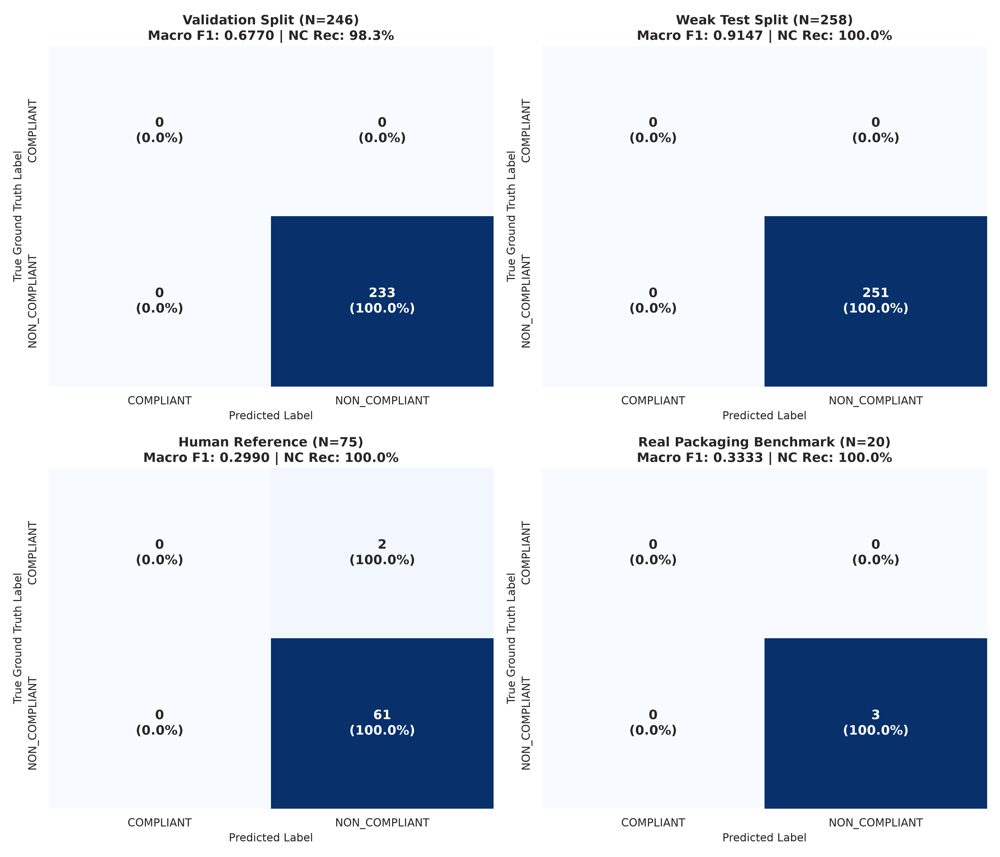

# Phase 13 — Confusion Matrix Analysis

## Executive Summary
Detailed confusion matrix breakdown across all evaluation partitions.



## Matrix Breakdown by Partition

### Validation (N=246)
```
                  Predicted COMPLIANT    Predicted NON_COMPLIANT
Actual COMPLIANT         0                       0                   
Actual NON_COMPLIANT     0                       233                 
```
- **True Positives (NON_COMPLIANT correctly flagged)**: 233
- **False Positives (COMPLIANT falsely flagged as NON_COMPLIANT)**: 0
- **False Negatives (NON_COMPLIANT missed as COMPLIANT)**: 0
- **True Negatives (COMPLIANT correctly cleared)**: 0

### Weak Test (N=258)
```
                  Predicted COMPLIANT    Predicted NON_COMPLIANT
Actual COMPLIANT         0                       0                   
Actual NON_COMPLIANT     0                       251                 
```
- **True Positives (NON_COMPLIANT correctly flagged)**: 251
- **False Positives (COMPLIANT falsely flagged as NON_COMPLIANT)**: 0
- **False Negatives (NON_COMPLIANT missed as COMPLIANT)**: 0
- **True Negatives (COMPLIANT correctly cleared)**: 0

### Human Reference (N=75)
```
                  Predicted COMPLIANT    Predicted NON_COMPLIANT
Actual COMPLIANT         0                       2                   
Actual NON_COMPLIANT     0                       61                  
```
- **True Positives (NON_COMPLIANT correctly flagged)**: 61
- **False Positives (COMPLIANT falsely flagged as NON_COMPLIANT)**: 2
- **False Negatives (NON_COMPLIANT missed as COMPLIANT)**: 0
- **True Negatives (COMPLIANT correctly cleared)**: 0

### Real Packaging (N=20)
```
                  Predicted COMPLIANT    Predicted NON_COMPLIANT
Actual COMPLIANT         0                       0                   
Actual NON_COMPLIANT     0                       3                   
```
- **True Positives (NON_COMPLIANT correctly flagged)**: 3
- **False Positives (COMPLIANT falsely flagged as NON_COMPLIANT)**: 0
- **False Negatives (NON_COMPLIANT missed as COMPLIANT)**: 0
- **True Negatives (COMPLIANT correctly cleared)**: 0
