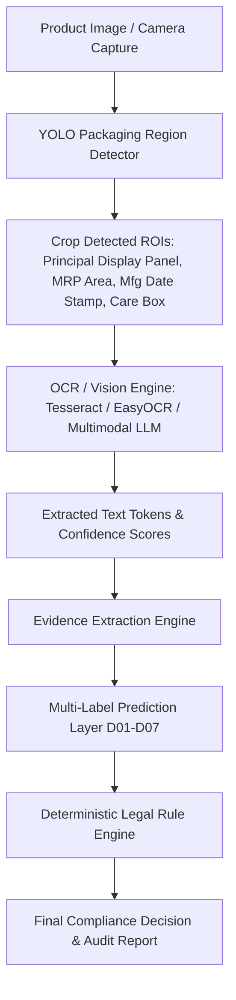

# YOLO Visual Evidence Integration Strategy

## 1. Context & Architectural Separation
The candidate YOLO dataset (`data/external/yolo_candidate_dataset/`) contains object detection bounding boxes for packaging regions.

> [!IMPORTANT]
> **Strict Task Decoupling**:
> YOLO object detection labels (bounding boxes on physical package labels) are **NOT** compliance labels.
> They represent spatial regions of interest (ROIs) on physical product packaging.
> They must remain decoupled from the Legal Metrology declaration target schema (`D01`–`D07`).

---

## 2. Multi-Modal Verification Architecture

---

## 3. Integration Stages & Experimental Roadmap

1. **Stage 1 (Text & Metadata Baseline — Current Phase)**:
   - Establish multi-label compliance prediction on structured text, descriptions, and specifications (`flipkart_weak_labels_v1`).
2. **Stage 2 (YOLO Region Detection & Cropping — Future Milestone)**:
   - Train/fine-tune YOLO model to localize declaration boxes on physical packaging images (front, back, side panels).
   - Filter low-resolution or non-packaging lifestyle images.
3. **Stage 3 (OCR Feature Extraction & Fusion)**:
   - Run OCR over cropped ROIs and fuse OCR tokens with listing text features into the multi-modal compliance classifier.
4. **Stage 4 (End-to-End Evaluation)**:
   - Evaluate multimodal pipeline against physical package image benchmarks.
