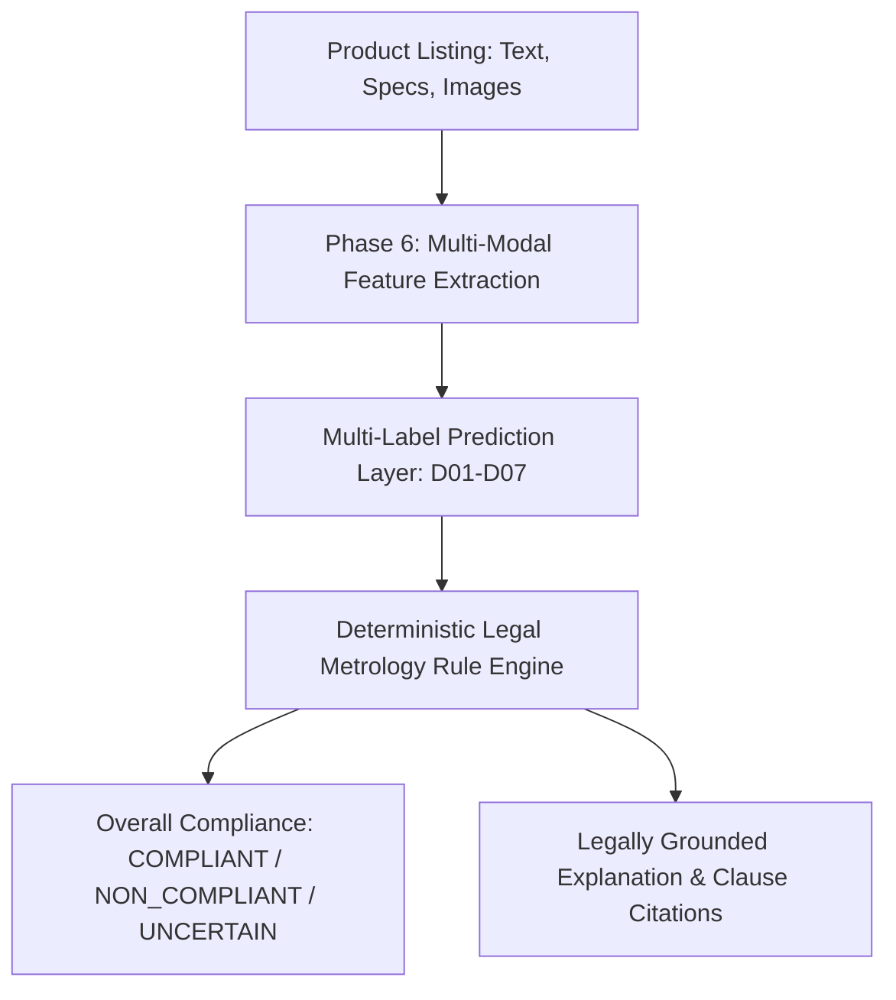

# Phase 6 Prerequisites & Feature Engineering Roadmap

## Overview

This document outlines the technical prerequisites, architectural design decisions, and feature engineering roadmap required for **Phase 6 — Feature Engineering**, based on the validated 75-product ground-truth dataset from Phase 5.

---

## 1. Core ML Formulation: Multi-Label Declaration Prediction

### Why Multi-Label Declaration Prediction?
- Under Legal Metrology (Packaged Commodities) Rules, 2011, overall compliance is a **deterministic legal function of the 7 mandatory declarations** (Rule 6).
- Attempting to predict binary `COMPLIANT / NON_COMPLIANT` directly as a monolithic black-box model creates high error rates, uninterpretable legal claims, and severe class imbalance.
- The hybrid NitiMark architecture solves this by training models to predict the presence/status of individual declarations:
  $$\hat{Y} = [\hat{D}_{01}, \hat{D}_{02}, \hat{D}_{03}, \hat{D}_{04}, \hat{D}_{05}, \hat{D}_{06}, \hat{D}_{07}]$$
- The deterministic legal rule engine then verifies overall compliance and generates legally grounded explanations.

---

## 2. Feature Engineering Requirements for Phase 6

### A. Text & Metadata Features
1. **Title & Description Token Features**: TF-IDF, character n-grams, and pre-trained multilingual domain embeddings for Indian retail goods.
2. **Regex / Keyword Pattern Matches**:
   - Quantity regex matchers (e.g. `\b\d+\s*(?:g|gm|kg|ml|l|pack of \d+)\b`).
   - Customer care regex matchers (toll-free `1800-xxx-xxxx`, `care@`, `customer care`).
   - Country of origin keyword matches (`Made in`, `Country of Origin`).
   - Address / Pincode regex matchers (6-digit Indian PIN codes, `Dist.`, `Road`, `Nagar`).

### B. Structured Specification Features
1. **Key-Value Dictionary Encodings**: Number of specification keys, presence of known manufacturer/packer keys, quantity keys, origin keys.
2. **Field Presence Flags**: Binary flags for `has_brand`, `has_retail_price`, `has_discounted_price`, `has_description`, `spec_key_count`.

### C. Multimodal / Image Features
1. **Image Count & Resolution**: Total images, aspect ratio, resolution.
2. **OCR Extraction Pipeline**: Text extracted from packaging bounding boxes using vision/OCR models.
3. **Packaging Text Embeddings**: OCR text similarity to listing metadata.

---

## 3. Train / Validation / Test Grouping Strategy

To prevent data leakage during dataset expansion and model training:
1. **Grouped Splitting by Brand / Category**: Products from the same brand or identical category sub-trees should be grouped together to prevent memorization of brand names.
2. **Stratified Multi-Label Splitting**: Maintain representation of rare declaration classes (e.g. `D01: PARTIAL`, `D06: ABSENT`) across folds.
3. **Immutability of Ground Truth**: Ground truth labels remain frozen in `data/processed/`.

---

## 4. Dataset Expansion Sampling Recommendation

- **Current Pilot**: 75 unique products (validated annotation baseline).
- **Target Expansion**: 350–500 human-reviewed products.
- **Stratified Sampling Strategy**:
  1. Increase representation of underrepresented categories (e.g. *Baby Care*, *Kitchen & Dining*, *Packaged Foods*).
  2. Sample products with varying specification completeness (sparse vs dense specs).
  3. Include products with high-resolution packaging images for multimodal validation.
