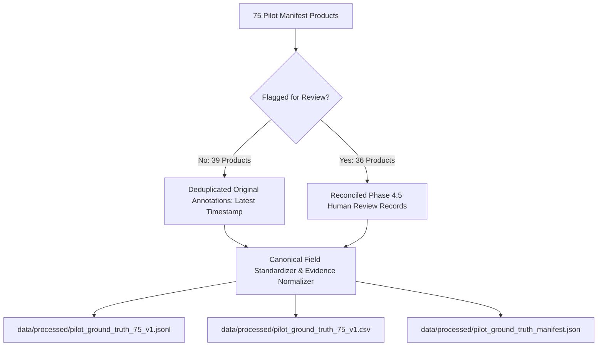

# Pilot Record Reconciliation Report (Phase 5)

## Executive Summary

This report documents the reconciliation of all annotation and review records in the NitiMark Legal Metrology Pilot Dataset (PS25057). 

- **Target Sample**: Exactly 75 unique products specified in [`annotations/pilot_manifest.csv`](file:///home/devabhay07/Desktop/MLmodelV2/annotations/pilot_manifest.csv).
- **Original Pilot Annotations**: 78 raw JSONL records in [`annotations/pilot_annotations.jsonl`](file:///home/devabhay07/Desktop/MLmodelV2/annotations/pilot_annotations.jsonl) representing 75 unique products.
- **Phase 4.5 Human Reviews**: 37 review records in [`annotations/review_36_results.jsonl`](file:///home/devabhay07/Desktop/MLmodelV2/annotations/review_36_results.jsonl) representing all 36 flagged inconsistent products.
- **Finalized Ground Truth**: Exactly 75 unique, validated records in [`data/processed/pilot_ground_truth_75_v1.jsonl`](file:///home/devabhay07/Desktop/MLmodelV2/data/processed/pilot_ground_truth_75_v1.jsonl).

---

## 1. Investigation of 78 Original Records vs. 75 Unique Products

The 3 additional records in `pilot_annotations.jsonl` were investigated. None were caused by data corruption or multiple conflicting annotators. All 3 represent **rapid consecutive re-annotations** by the same human annotator (`annotator_01`) correcting or updating a label immediately after initial submission:

### Case 1: Product `150f0154de8f25165c9b25db63f9ed11`
- **Record 1 Timestamp**: `2026-09-03T21:59:34.009193+00:00`
  - Annotations: `D01: PRESENT`, `D02: PRESENT`, `D03: PRESENT`, `D04: PRESENT`, `D05: PRESENT`, `D06: ABSENT`, `D07: PRESENT`. Overall: `NON_COMPLIANT`.
- **Record 2 Timestamp**: `2026-09-03T22:00:20.217292+00:00` (46 seconds later)
  - Annotations: `D01: ABSENT`, `D02: PRESENT`, `D03: PRESENT`, `D04: PRESENT`, `D05: PRESENT`, `D06: ABSENT`, `D07: PRESENT`. Overall: `NON_COMPLIANT`.
- **Resolution**: Record 2 represents the intentional correction where the annotator realized the manufacturer address was absent. The latest timestamp is preserved.

### Case 2: Product `9ed8c3eeef76ac201ddebab9dbb5c04b`
- **Record 1 Timestamp**: `2026-09-04T20:34:29.829309+00:00`
  - Annotations: All 7 `PRESENT`, Overall: `NON_COMPLIANT`.
- **Record 2 Timestamp**: `2026-09-04T20:35:07.731189+00:00` (38 seconds later)
  - Annotations: All 7 `PRESENT`, Overall: `NON_COMPLIANT` (re-saved with identical fields).
- **Resolution**: Duplicate re-submission; flagged for Phase 4.5 review and successfully resolved in review.

### Case 3: Product `735820e1614052fde55659da9dc10ccc`
- **Record 1 Timestamp**: `2026-09-04T20:37:33.418257+00:00`
  - Annotations: All 7 `PRESENT`, Overall: `COMPLIANT`.
- **Record 2 Timestamp**: `2026-09-04T20:37:50.060470+00:00` (17 seconds later)
  - Annotations: All 7 `PRESENT`, Overall: `NON_COMPLIANT`.
- **Resolution**: Rapid re-annotation; flagged for Phase 4.5 review and successfully resolved in review.

---

## 2. Investigation of 37 Review Records vs. 36 Reviewed Products

In [`annotations/review_36_results.jsonl`](file:///home/devabhay07/Desktop/MLmodelV2/annotations/review_36_results.jsonl), 36 unique products were reviewed with 37 total records:

### Product `015d31ad501bf22af9526da45b2a30fe` (BrandTrendz Wheel Pizza Cutter)
- **Review 1 (`2026-09-04T21:41:03.074819+00:00`)**:
  - Reviewer: `reviewer_01`, Decision: `CONFIRMED`.
  - Revised Declarations: `D01: PARTIAL`, `D02: PRESENT`, `D03: PRESENT`, `D04: CANNOT_DETERMINE`, `D05: PRESENT`, `D06: ABSENT`, `D07: CANNOT_DETERMINE`.
  - Overall: `NON_COMPLIANT`.
  - Reason: Detailed justification citing partial brand details, absent customer care, and undetermined manufacturing date/origin.
  - Action: `ACCEPTED_AI_DRAFT` with full evidence notes.
- **Review 2 (`2026-09-04T22:26:33.987077+00:00`)**:
  - Re-submission where default form dropdowns remained unpopulated.
- **Resolution**: Review 1 contains the complete, evidence-based human verification and was selected as the finalized ground-truth record.

---

## 3. Ground Truth Assembly Architecture

---

## 4. Preservation & Immutability Rules
1. `annotations/pilot_annotations.jsonl` remains **100% untouched** (matches backup byte-for-byte).
2. `annotations/review_36_results.jsonl` remains **100% untouched** as an append-only audit trail.
3. The finalized ground-truth dataset contains exactly **75 unique products** with 100% human verification.
